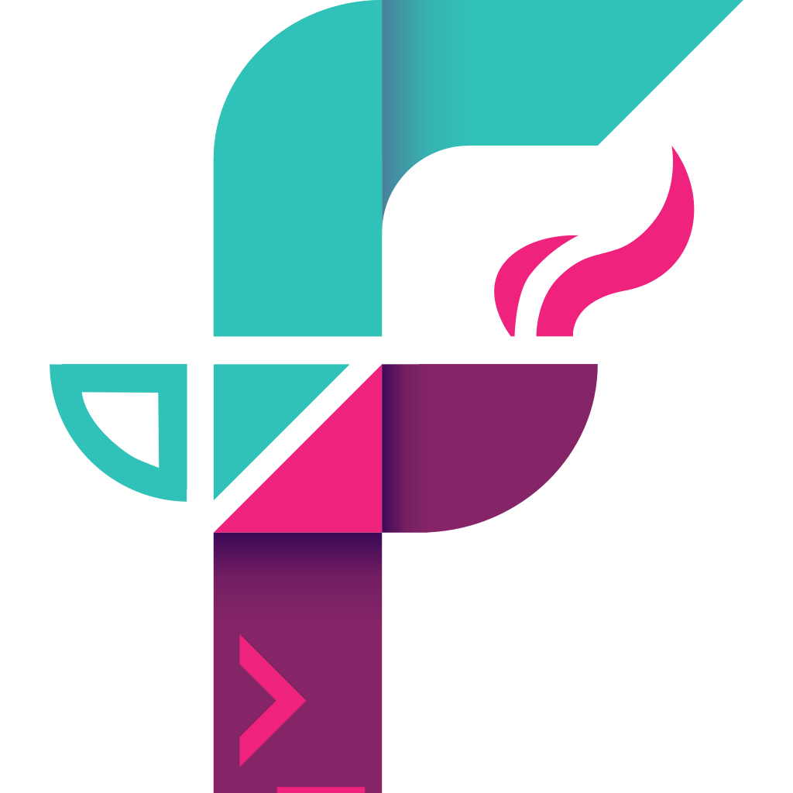
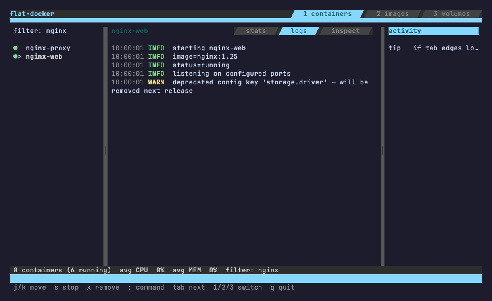

<p align="center">
  
</p>

# Flatte

[](https://github.com/lunguini/flatte/actions/workflows/ci.yml)
[](https://pkg.go.dev/github.com/lunguini/flatte)
[](LICENSE)
[](https://flatte.lunguini.com)

Flatte is a Go TUI foundation built around one mutable state struct, direct
state mutation, and pure views. It is intentionally not a Bubble Tea clone:
apps do not define messages, commands, or component update trees. State lives
in your app, `Handle` mutates it, and `View` renders it.

[](https://flatte.lunguini.com)

<sub>A glimpse of the [sample apps](examples.md) — Snake, a Docker-style TUI,
a three-pane workspace, styling, tables, progress — all built from the
primitives below. **[Try Flatte live in your browser →](https://flatte.lunguini.com)**
· regenerate the reel with [`cmd/record-demo.sh`](cmd/record-demo.sh).</sub>

The module path is currently:

```bash
go get github.com/lunguini/flatte
```

The root package name is `flatte`, so ordinary imports use the `flatte`
identifier:

```go
import "github.com/lunguini/flatte"
```

## Minimal App

```go
package main

import (
	"context"
	"fmt"
	"os"

	"github.com/lunguini/flatte"
)

type State struct {
	count int
}

func Handle(s *State, ev flatte.Event, fx flatte.Effects[State]) {
	key, ok := ev.(flatte.KeyEvent)
	if !ok {
		return
	}
	switch key.Key {
	case flatte.KeyEscape:
		fx.Quit()
	case flatte.KeyCharacter:
		switch key.Rune {
		case '+':
			s.count++
		case '-':
			s.count--
		case 'q', 'Q':
			fx.Quit()
		}
	}
}

func View(s *State, ctx flatte.RenderContext) flatte.Frame {
	return flatte.Frame{Content: fmt.Sprintf("count: %d\n\n+/- change  q quit", s.count)}
}

func main() {
	if err := flatte.Run(context.Background(), flatte.App[State]{
		State:  &State{},
		Handle: Handle,
		View:   View,
	}); err != nil {
		fmt.Fprintln(os.Stderr, err)
		os.Exit(1)
	}
}
```

## Mental Model

- `State` is the single source of truth.
- `Handle(state, event, effects)` mutates state directly.
- `View(state, context)` returns a full `flatte.Frame`.
- Async work goes through named helpers: `flatte.Go`, `flatte.Every`,
  `flatte.Stream`, and `flatte.Latest`.
- Widgets in `flatui` are opt-in state structs. They own no goroutines and no
  key policy.
- Tests use normal field assertions plus `flatest` golden/harness helpers.

## Current terminal input scope

Flatte currently delivers key presses (including F1–F12), paste, focus,
mouse, clipboard, and resize events through its closed `Event` set. Key
release events and terminal capability/keyboard-enhancement reports are not
delivered. Composite or IME text is currently reduced to the first rune of a
key event. `PasteEvent` preserves multi-rune pasted strings, but it is not an
IME substitute; applications requiring composition must wait for a dedicated
text-input API.

Inline rendering cannot be combined with mouse reporting: `Run` returns
`ErrInlineMouseUnsupported`. Inline frames can move as scrollback is printed,
so Flatte does not claim frame-relative mouse coordinates in that mode.

`ResizeEvent` is emitted initially. On Unix, later terminal resizes arrive via
`SIGWINCH`; on Windows, ultraviolet receives console window-size events from a
real Windows console. The repository's Windows checks compile and run tests,
but piped input is not evidence of live console-resize behavior; verify that
path in an actual Windows console before relying on it operationally.

The repository includes an opt-in real-console gate. In PowerShell on Windows,
build the test binary, run it directly, and resize the console once:

```powershell
go test -c -o flatte-resize-smoke.exe .
$env:FLATTE_WINDOWS_RESIZE_TTY = "1"
.\flatte-resize-smoke.exe -test.run TestWindowsConsoleResizeTTY -test.v
```

## Packages

- `github.com/lunguini/flatte` (`flatte`) - runtime, events, effects, frame,
  cursor, clipboard, exec, file selection.
- `github.com/lunguini/flatte/flatui` - stateful UI helpers such as `TextField`,
  `Textarea`, `Viewport`, `List`, `Table`, `Tree`, `FocusRing`, `Paginator`,
  `Progress`, `Spinner`, `Timer`, and `Stopwatch`.
- `github.com/lunguini/flatte/flatui/layout` - flexbox-style layout engine
  (`Row`, `Col`, `Text`, `Spacer`) that solves a frame tree once into composed
  content plus per-ID rects for geometry-based hit-testing.
- `github.com/lunguini/flatte/flatest` - deterministic app driver, golden
  assertions, frame rendering, and replay helpers.

## Navigation Patterns

Use plain state:

- Multiple full screens: store a `screen` enum in `State` and switch in
  `Handle` and `View`. See `cmd/flat-pages`.
- Multiple focusable sections on one screen: store a `flatui.FocusRing`. See
  `cmd/flat-workspace`.
- Modal/overlay state: store `modalOpen bool` and modal-specific fields. See
  `cmd/flat-modal`.

## Useful Commands

The library and samples are separate modules:

```bash
go test ./...
go vet ./...

cd cmd
go test ./...
go run ./flat-pages
go run ./flat-workspace
```

## Thanks

Flatte stands on a lot of excellent open-source work:

- **[Charm](https://charm.sh)** — Flatte is the deliberate inverse of
  [Bubble Tea](https://github.com/charmbracelet/bubbletea), but it happily
  reuses Charm's MIT-licensed substrate:
  [Lip Gloss](https://github.com/charmbracelet/lipgloss) for styling,
  [Ultraviolet](https://github.com/charmbracelet/ultraviolet) for input parsing
  and cell-buffer rendering, and [`x/ansi`](https://github.com/charmbracelet/x)
  and [`colorprofile`](https://github.com/charmbracelet/colorprofile)
  underneath. Bubble Tea also serves as our honest benchmark — the
  `cmd/bubble-*` comparison apps keep our claims grounded. Thank you, Charm
  team.
- **[rivo/uniseg](https://github.com/rivo/uniseg)** for correct Unicode
  grapheme segmentation, so cursors and widths behave.
- **The [Go](https://go.dev) team** for the language, `golang.org/x/term`, and
  first-class WebAssembly support that powers the browser demo in
  `cmd/flat-landing`.

## Further Reading

- [Quick Reference](quick-reference.md) maps common TUI needs to Flatte APIs.
- [Examples](examples.md) maps every sample app to the capability it
  demonstrates.
- [Contributing](CONTRIBUTING.md) covers Conventional Commits, the quality
  bar, and the golden-snapshot policy.
- [Changelog](CHANGELOG.md) is generated from commit messages on each
  release.

## Compatibility and current limits

Flatte is pre-1.0. The public packages follow Go module versioning, and
breaking API changes are called out in the changelog; the API snapshot test is
a regression guard, not a promise that every 0.x release is source-compatible.
Ultraviolet and Lip Gloss are implementation dependencies: applications use
Flatte's events, frames, and layout types rather than substrate types.

`Async` is a deprecated raw-channel compatibility bridge and is planned for
removal in the next pre-1.0 minor release that accepts breaking changes; use
`Go` or off-loop `Effects.Send`. `NewHarnessEffects` and
`NewHarnessEffectsQueue` are exported only so external deterministic harnesses
can construct effects without a `flatte`/`flatest` import cycle. They are not
application APIs and will be reviewed for relocation or consolidation before
1.0.

See [Current terminal input scope](#current-terminal-input-scope) for the
current input and resize limitations. Apps should size scrollable content with
`flatui.Viewport` and use `layout.SolveAndCompose` when they need frame geometry
for hit-testing.
